# FurLink Platform Documentation & Technical Manual
**No-Kill Animal Rescue, Adoption Registry & Clinical Sanctuary System**

---

## 1. Executive Summary & Architecture

FurLink is a production-grade web application built for an animal welfare organization and sanctuary alliance based in Belagavi, Karnataka. The system was designed from the ground up under two governing design and engineering principles:

1. **Strict Conversion Focus**: Every visitor interaction, typography scale, and call-to-action directly drives one of two primary human actions: **ADOPT** or **DONATE**.
2. **Editorial Case File Concept**: *"Every animal has a name before a number."* Animals are treated not as commercial inventory in a catalogue grid, but as individual living beings with unique medical histories, temperament quirks, and verified waiting days.

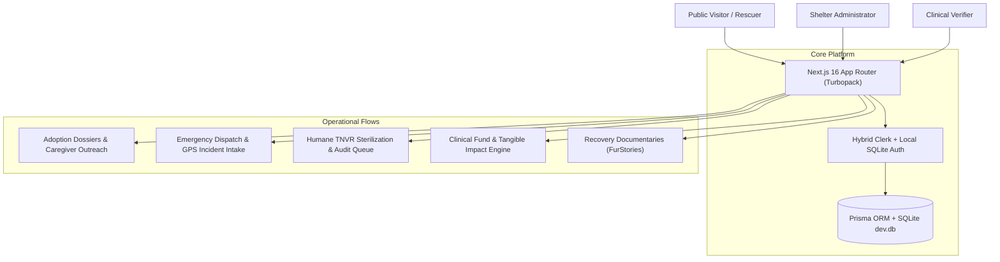

### Visual Identity System
* **Background Palette**: Blush ground (`#f3c9d5`), ink print copy (`#1A2540`), terracotta accent (`#cc2b3f`), warm cream paper backing (`#f2e9db`).
* **Typography Hierarchy**: League Spartan (800 / 900 heavy uppercase) for display headlines; Poppins (400 / 500 / 600) for editorial narrative body text; Martian Mono for docket reference numbers, case IDs, and waiting day counters.
* **Material System**: Visual elements are modeled after print-shop material states: kiss-cut borders, dashed die-cut lines, folded corner flaps, and sealed verification stamps.
* **Offline Self-Sufficiency**: Powered entirely by an embedded SQLite engine with zero third-party database network dependencies.

---

## 2. Public Platform Experience & User Flows

### 2.1 Editorial Home Interface & Hero Ledger
The home page immediately establishes emotional connection without sentimental fluff. It presents verified waiting counters, recovery meals sponsored, and the Verified Adopter Family Registry.

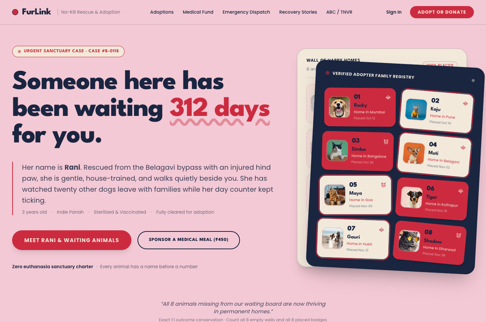

#### Key Capabilities:
* **Permanent Live Counter**: Calculates real elapsed days since sanctuary intake.
* **Proof Exhibit**: Features real alumni profiles and registered adoptive homes.
* **Clean Public Navigation**: Features five clear links (*Adoptions*, *Medical Fund*, *Emergency Dispatch*, *Recovery Stories*, *ABC / TNVR*) with a mobile slide drawer.

---

### 2.2 The Waiting Wall & Adoption Catalog
Located at `/adoptions`, the Waiting Wall organizes animals awaiting adoption by urgent medical need and wait duration.

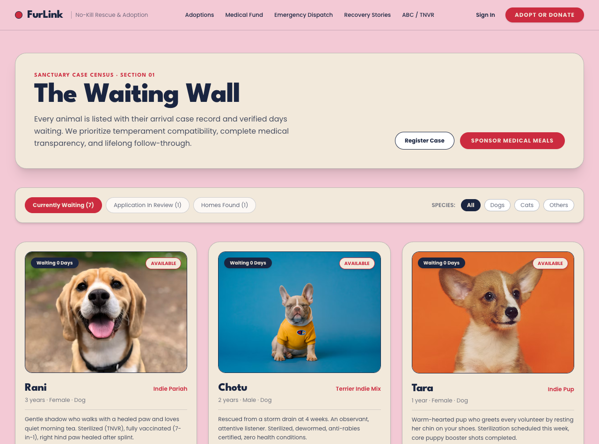

#### Filtering & Organization:
* **Status Tabs**:
  * *Currently Waiting*: Active residents seeking forever homes.
  * *Application In Review*: Animals with pending applicant screenings.
  * *Homes Found*: Completed adoption alumni.
* **Species Filter Chips**: One-click toggling between Canine, Feline, and Community animals.
* **Case Reference Tags**: Each card displays age, gender, medical protocol completion, and days elapsed.

---

### 2.3 Individual Case Dossier & Caregiver Coordination Flow
Located at `/adoptions/[id]`, each animal features an individualized documentary profile detailing clinical interventions, behavior, and physical location.

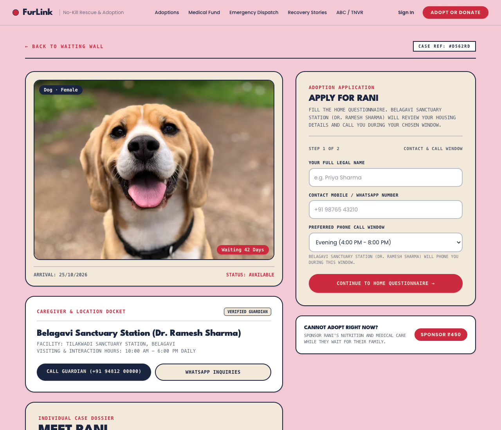

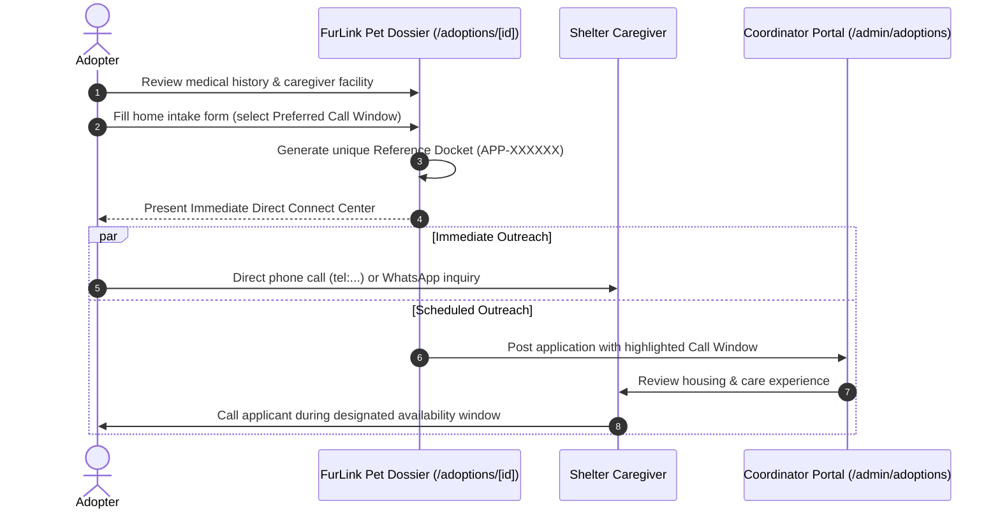

#### Feature Breakdown:
1. **Direct Caregiver & Location Docket**:
   * Lists the exact sanctuary station (e.g. *Tilakwadi Sanctuary Station, Belagavi*) and visiting hours.
   * Instant **"Call Guardian"** button (`tel:...`) connects straight to the caregiver in charge.
   * Instant **"WhatsApp Inquiries"** action pre-fills a detailed inquiry referencing the pet's case ID.
2. **Medical Protocol Checklist**: Displays TNVR certification status, 7-in-1 multi-spectrum vaccination, and anti-rabies immunizations.
3. **Application Intake Questionnaire**:
   * Collects applicant contact, street address, housing type, and pet experience.
   * **Preferred Call Window**: Allows applicants to designate *Morning (9 AM - 12 PM)*, *Afternoon (12 PM - 4 PM)*, *Evening (4 PM - 8 PM)*, or *Anytime*.
4. **Immediate Direct Connect Center**:
   * Appears immediately upon submission.
   * Gives applicants their reference docket code (e.g. `APP-A3B91C`).
   * Outlines the next three steps: document check, 15-minute phone interview during selected window, and shelter meet-and-greet visit.

---

### 2.4 Applicant Profile & Application Docket Tracking
Located at `/profile`, logged-in applicants can track all their interactions in one unified dossier:

* **Adoption Dossiers Section**: Displays each submitted application, current status (`PENDING`, `APPROVED`, `REJECTED`), the applicant's chosen call window, direct guardian phone number, facility address, and instant call/WhatsApp buttons.
* **Field Rescue Incident Reports**: Tracks reports filed by the user and current ambulance dispatch status.
* **TNVR Requests**: Shows street sterilization cases registered by the user.
* **Clinical Donations**: Provides transaction receipts and audit references.

---

### 2.5 Clinical Emergency Fund & Direct Impact Allocation Engine
Located at `/donate`, this interface translates monetary gifts into concrete medical and nutritional provisions.

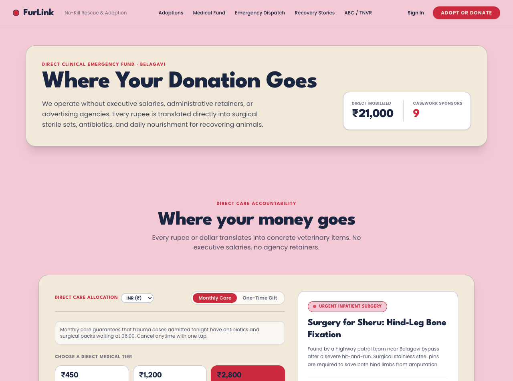

#### Impact Tier Allocation:
* **INR 450**: Supplies 9 days of nourishing recovery meals for one recuperating animal.
* **INR 1,200**: Covers core 7-in-1 multi-spectrum vaccines, anti-rabies vials, and tick prophylaxis.
* **INR 2,800**: Sponsors complete sterile TNVR surgical procedures and 5-day post-op hospital stay.
* **INR 6,500**: Underwrites trauma diagnostic x-ray plates and orthopedic bone-setting splints.
* **INR 12,000**: Underwrites an entire calendar month of inpatient nursing, IV fluids, and rehabilitation.
* **Multi-Currency Support**: Real-time conversion across INR, USD, and EUR.
* **Offline Test Donations**: Provides instant local confirmation tickets with unique transaction tokens.

---

### 2.6 Emergency Trauma Dispatch Feed & Intake Report
Located at `/rescues` and `/rescues/new`, this workflow enables rapid citizen reporting of roadside animal emergencies.

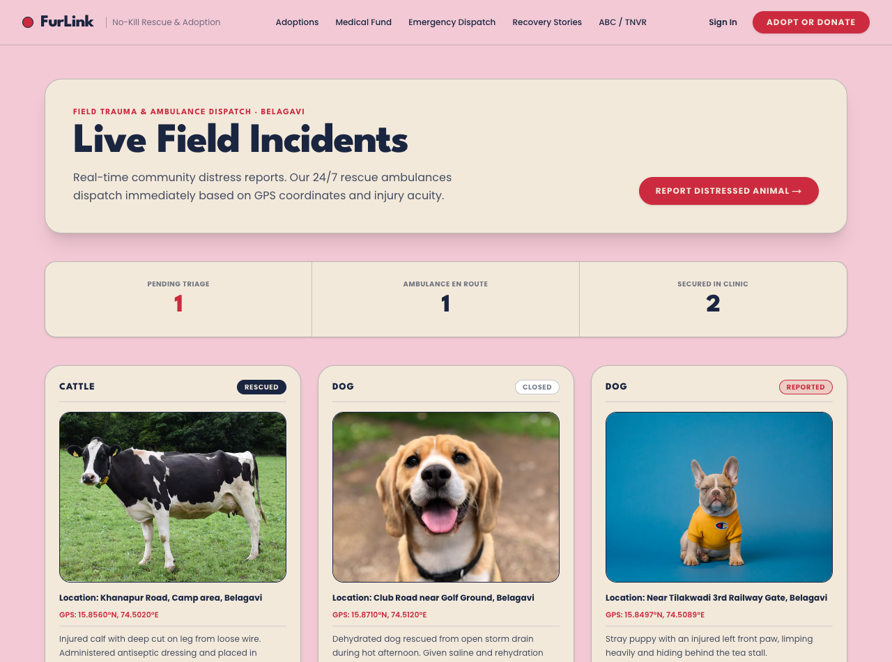

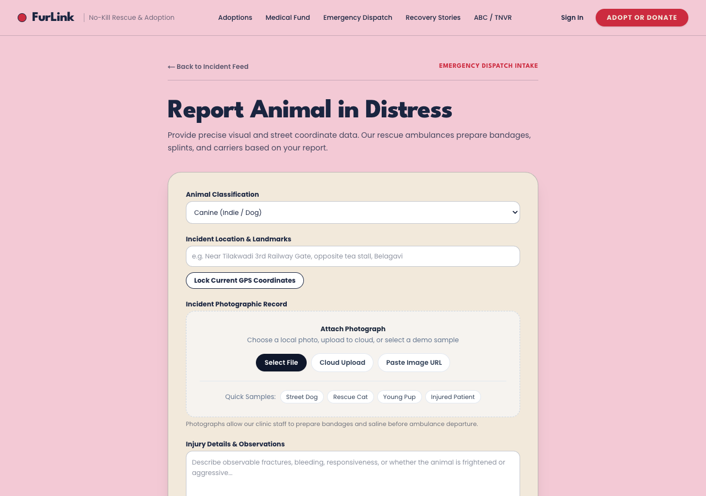

#### Technical Capabilities:
* **Real-Time Dispatch Statuses**: `REPORTED` (open triage), `IN_PROGRESS` (ambulance en route), `RESCUED` (admitted to clinic), `CLOSED` (stabilized/rehabilitated).
* **GPS Coordinate Capture**: Browser geolocation integration automatically populates latitude and longitude coordinates.
* **Offline-Resilient Photo Attachment**: Supports local file uploads via HTML5 `FileReader` data URLs, Cloudinary cloud integration, and quick demo presets.

---

### 2.7 Humane ABC / TNVR Sterilization Management
Located at `/sterilization`, this section coordinates Animal Birth Control (ABC) and Trap-Neuter-Vaccinate-Return (TNVR) programs.

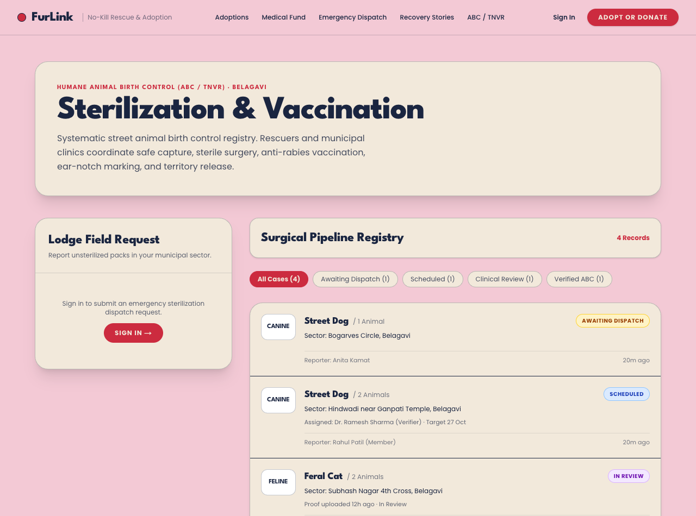

#### Lifecycle Stages:
1. **Request Logged (`PENDING`)**: Community member identifies an unsterilized group.
2. **Clinic Scheduled (`SCHEDULED`)**: Field rescuer claims the request and reserves hospital slots.
3. **Proof Submitted (`PROOF_SUBMITTED`)**: Rescuer uploads veterinary completion certificate and surgeon affidavit.
4. **Clinical Verification (`VERIFIED`)**: Authorized veterinary verifier approves proof and completes case.

---

### 2.8 Clinical Recovery Case Archives (FurStories)
Located at `/stories` and `/stories/new`, this editorial documentary section chronicles journeys from roadside trauma into rehabilitation.

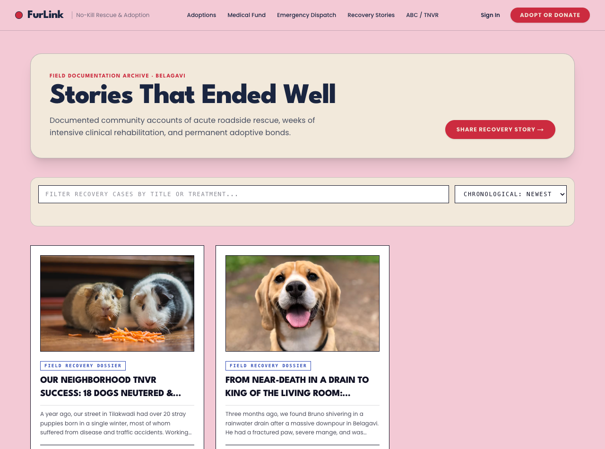

#### Functionality:
* Photographic carousel plates documenting day-of-rescue to full rehabilitation.
* Clinical interventions timeline and caregiver commentary.
* Authenticated community submission and administrative moderation pipeline.

---

## 3. Master Administrative Console (`/admin`)

The Administrative Console is accessible directly via `/admin`. It provides high-contrast operational controls for sanctuary directors, veterinary coordinators, and field dispatchers.

```mermaid
graph LR
    subgraph Admin Console Navigation (/admin)
        T1["01 Overview"]
        T2["02 Adoptions & Pets"]
        T3["03 Field Rescues"]
        T4["04 TNVR Sterilization"]
        T5["05 Verification Queue"]
        T6["06 Medical Donations"]
        T7["07 Recovery Stories"]
        T8["08 Guardian Users"]
        T9["09 Analytics & Impact"]
    end
```

### 3.1 Master Admin Top Bar & Global Controls
Every administrative view includes:
* **"Return to Public Website"**: A dedicated exit link returning to the public home page.
* **Operator Identification**: Displays the active administrator name, email, and security role.
* **Quick Create Shortcuts**: Rapid modals for `+ Pet`, `+ Rescue`, and `+ Story`.

---

### 3.2 Master Admin Overview
Located at `/admin`, the overview aggregates platform health, urgent action notices, and operational metrics.

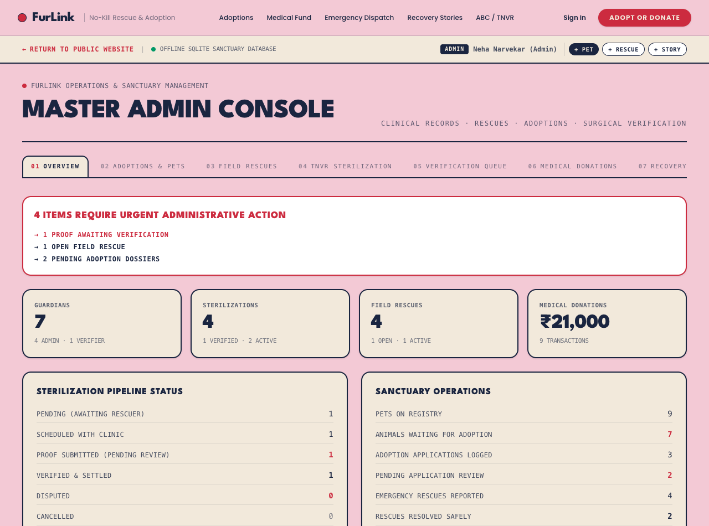

#### Dashboard Cards:
* **Urgent Action Banner**: Flags pending surgical proofs, open trauma dispatches, and unreviewed adoption applications.
* **KPI Metrics**: Real-time totals for registered guardians, surgical procedures, field rescues, and medical fund donations.
* **Pipeline Audits**: Breakdown of sterilization cases across all six lifecycle states.

---

### 3.3 Adoption Docket & Coordinator Portal
Located at `/admin/adoptions`, this screen allows coordinators to review applications, contact adopters, and update animal statuses.

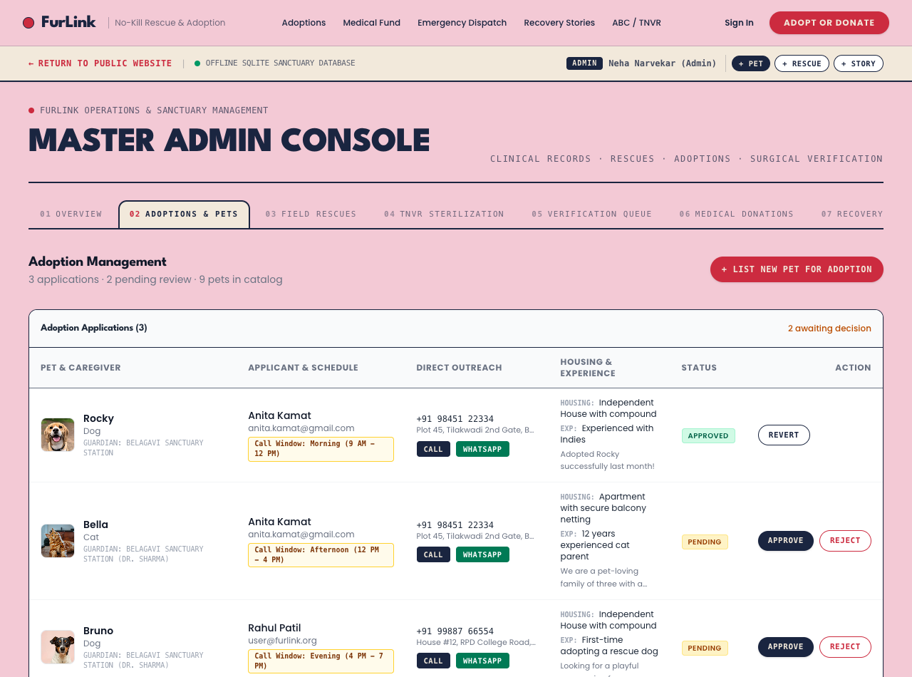

#### Coordinator Tools:
* **Call Window Badge**: Highlights the applicant's chosen time (e.g. *Window: Evening (4 PM - 8 PM)*).
* **Direct Outreach Actions**:
  * **"Call"** (`tel:...`): Initiates phone call directly to applicant.
  * **"WhatsApp"**: Pre-fills greeting message introducing the caregiver and linking the pet name.
* **Decision Controls**: One-click **Approve**, **Reject**, or **Revert** buttons that automatically synchronize pet catalog availability.

---

### 3.4 Field Rescue Dispatch Management
Located at `/admin/rescues`, this interface manages ambulance fleet dispatches and roadside incident resolution.

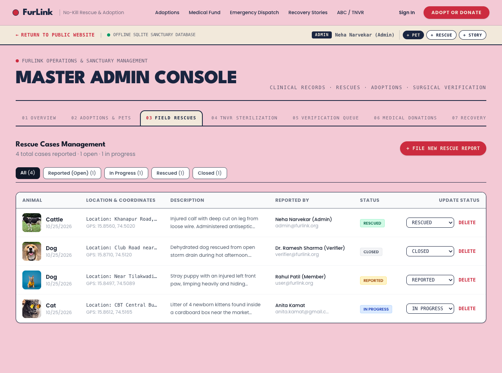

#### Dispatch Workflow:
* Filter cases across *Reported (Open)*, *In Progress*, *Rescued*, and *Closed*.
* Review reported GPS coordinates, street addresses, and distress descriptions.
* Dispatch emergency ambulances and update patient status in real time.

---

### 3.5 Guardian Users & Access Control
Located at `/admin/users`, directors can manage user permissions and promote team members.

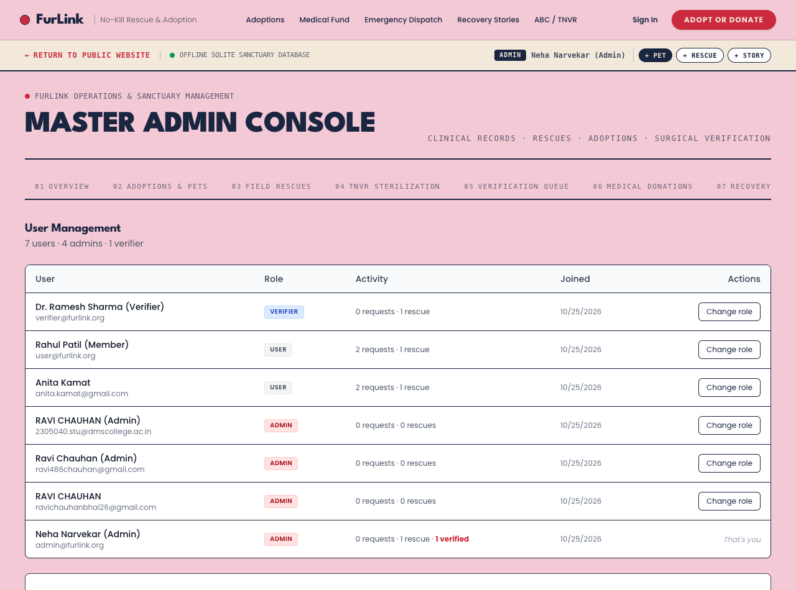

#### Role Hierarchy:
* `USER`: Can file rescue reports, adopt pets, submit TNVR requests, and donate.
* `VERIFIER`: Can inspect surgical certificates, verify veterinary affidavits, and resolve sterilization disputes.
* `ADMIN`: Full master access to user roles, catalog creation, financial ledgers, and system configurations.

---

### 3.6 Medical Donations & Financial Ledger
Located at `/admin/donations`, this portal provides a public and internal audit record of all transactions.

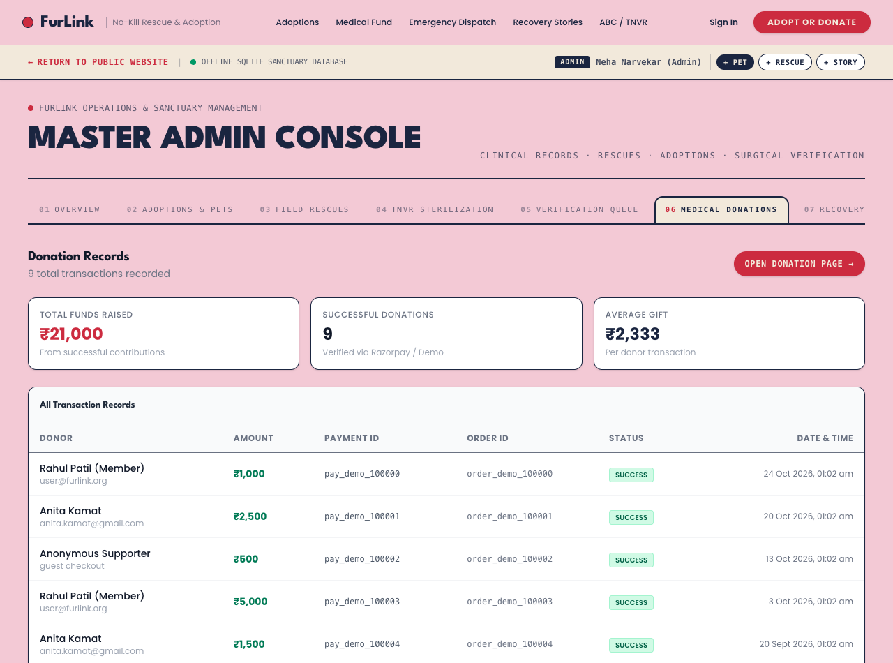

#### Financial Controls:
* Aggregate metrics: Total Funds Raised, Verified Donations, Average Contribution.
* Full itemized ledger displaying donor name, payment ID, order ID, and exact timestamp.

---

### 3.7 Clinical Verification Audit Queue
Located at `/admin/verifications` (and `/verify`), veterinary verifiers audit field sterilization submissions.

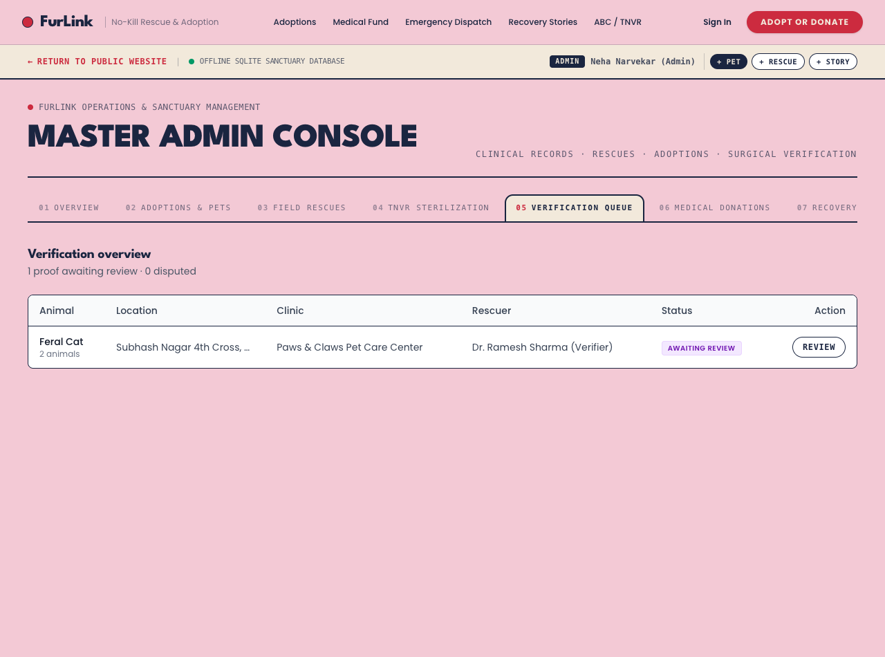

#### Verification Workflow:
* Inspects uploaded veterinary certificates and clinic affidavits.
* Direct action controls to approve verification or flag cases for clinical dispute.

---

## 4. Database Schema & Data Models

The platform runs on an embedded SQLite database (`prisma/dev.db`) managed through Prisma ORM v6.19.3.

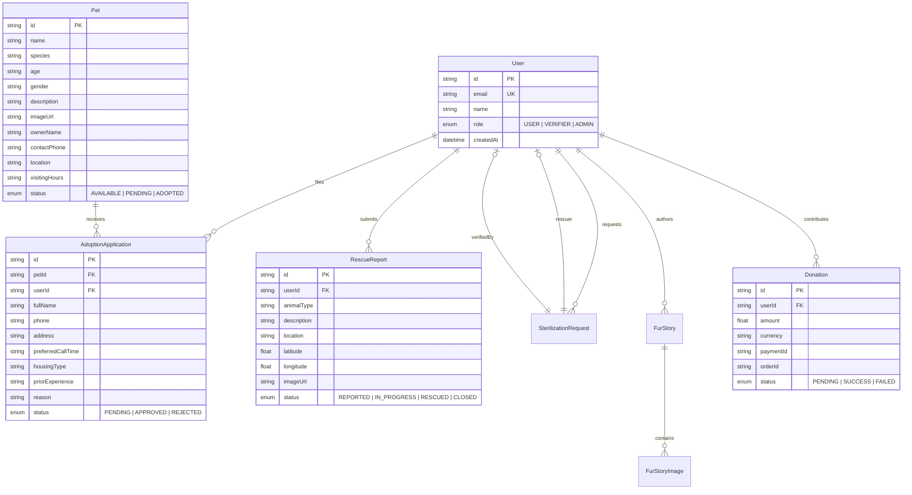

---

## 5. Security & Deployment Summary

* **Role-Based Guards**: Protected endpoints and actions verify user roles via `requireAdmin()` and `requireVerifier()` helper modules.
* **Strict Privacy on Public Navbar**: Public interfaces are clean and free of administrative controls or role-switching widgets.
* **Zero External Dependencies**: Operates offline without external cloud databases, allowing local development and standalone offline clinic deployment.
* **Zero Emojis**: All UI views, copy, comments, and documentation maintain strict compliance with the zero-emoji guideline.
